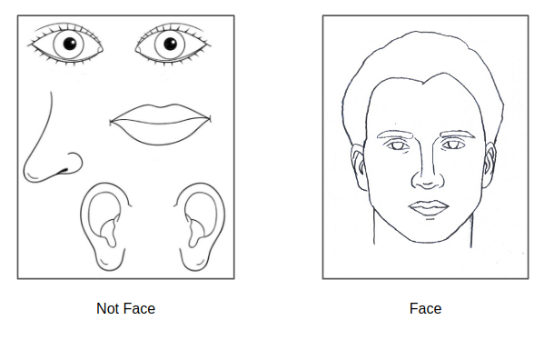

# Regularization

nn 모델이 학습할 때, high variance로 생기는 overfitting을 해결하며, hyperparameter을 여러 차례 수정함으로 써, bias/variance를 낮게 만드는 방법.

## Vanishing/exploding gradients

만약에 layer = inf 형태의 nn model이고, 모든 layer의 weight를 값은 값으로 지정할 수 있다고, 가정했을 때 우리는 아래와 같은 사고를 할 수 있다.

$$
w^{[l]} = [[1.5,0],[0,1.5]], (w^{[l]})^{\inf} \approx \inf
$$

weight가 1보다 작은 경우도 동일하다. 따라서 이로인해, 발산하거나 소멸하여, 연산이 느려지게 되는 문제가 있다. 이러한 문제를 해결하기 위해 regularization을 사용한다. 또는 initialize 를 통해 partial problem solve를 하기도 한다.

## data set

여러 application에서의 공통적인 hyperparameter recipe를 정의하기가 어렵기 때문에, 우리는 아래의 iteration을 여러번 시도하여, 적절한 값을 탐색한다.

$$
idea \rightarrow code \rightarrow experiment
$$

그래서 이를 evaluation/estimate 하기 위해 dataset을 적절하게 분배하고, 역할을 구별해야 한다.

### 1. train set

학습에 사용되는 데이터 셋으로써, 모델의 parameter update를 위해 사용되는 데이터들이다.

### 2. train-dev set

학습에 사용되는 데이터 셋으로써, holdout/cv/development등 여러 명칭이 있다. 여러 $\theta$ 중 가장 나은 알고리즘을 선택하기 위해 사용된다.

### 3. dev set

실제 test set에서의 performance를 추정하기 위해, 사용된다 (without bias). 이 데이터 셋은 test set의 distribution을 유추하여, 동일시 해야 하며, 이 set으로는 tuning을 하면 안된다.

### 4. test

우리가 얻을 수 없는 실제 세계의 데이터들 이며, 여러 이유로 인해, 이상적인 실제 train set과는 distribution이 다른 경우가 많다.

---

따라서 이러한 데이터 셋들의 역할들을 중점으로 분할을 할때, 전체 데이터 셋의 양과, 목적에 맞게 set의 양을 조절한다.

예를 들어 데이터가 10000개 있다고 하면, train data set 자체의 용량이 적기 때문에, 20%씩 train-dev와 dev로 떼어야 할 것이다. 하지만 데이터가 1million 있다고 하면, 0.1% = 1000개 이기 때문에, 20%까지 필요 없을 것이다. 이를 train set에 사용하면 좀 더 큰 nn 모델을 학습시킬 수 있는 data 양이 나올 것이다.

### mismatch

위 data set들 중, train-dev set과 dev set의 distribution이 다른 경우이다.

먼저 mismatch가 중요한 이유는, 만약 train set, dev set으로만 판단한다면, nn 모델의 overfitting을 우선적으로 의심할 것이다. 하지만, train-dev set과 train set을 통해 overfitting이 아님이 확인되면, train과 test set의 분포가 다르다는 것을 의심해야 한다.

이를 해결하기 위해서는 data argumentation을 진행하여, 데이터 양과 다양성을 증가시킨다.

추가로, dev set의 역할은 estimate algorithm without bias 인데, 만약 상황에 따라 편향되지 않은 추정치가 필요 없다면, train에 포함시켜, 학습을 도와주는 방향도 있다.

## Bias/Variance

underfitting은 high bias로 인해 생기며, overfitting은 hig variance로 인해 생긴다. 이는 visualization을 통해 (3차원 이상은 데이터의 boundary를 그리기 쉽지 않기 때문에, 2차원 이하에서만) 쉽게 확인할 수 있다.

기존에 ML에서는 bias-variance trade off가 있다고 생각하였지만, nn이 등장하면서, 크기를 exponential하게 size up 하게 된다면, variance가 줄어들어, double descent가 일어나서, trade off 가설이 무산되었다.

| bias | variance | condition                                        |
| ---- | -------- | ------------------------------------------------ |
| low  | low      | good                                             |
| low  | high     | overfitting                                      |
| high | low      | underfitting                                     |
| high | high     | some area underfitting and some area overfitting |

총 4가지의 bias/variance에 따른 condition을 구별할 수 있는데, 최종적으로 둘 다 낮추는 것을 목표로 해야 한다.

하지만 low/high를 판단할때는, train/dev error을 무작정 0%를 목표로 잡는 것이 아니라, human-level performance와 bayes error을 기반으로 유추해야 한다.

현실 세계에서는 대부분 human-level error을 bayes error의 근사치로 두고, 알고리즘을 측정하며, 특정 분야에서는 bayes error가 human-level error보다 더 낮기도 하다.

### 1. low human-level performance

저차원 classifier에서 볼 수 있는데, 이때 model의 train/dev set error를 1% 근방으로 와야지 bias/variance가 low 하다고 판단할 것이다.

### 2. high human-level performance

이때 model의 train/dev set error가 약 15%라고 하더라도, human-level error가 약 15%라고 하면, 이는 성능 좋은 classifier라고 판단할 수 있으며, 더 낮은 error는 달성하기 어려울 것이라고 판단할 수 있따.

### basic recipe

high bias : bigger network, train longer
high variance : more data, regularization

전제 : human-level performance that task well.

또한 한번만 시행하는 것이 아닌, iteration을 여러번 하여, bias/variance가 둘다 잘 감소하고 있는지를 계속 확인해야 하며, 재학습을 시도해 보아야 한다.

## Regularization

여러가지 방법을 통해 high variance 를 해소할 수 있다.

- weight decay
- drop out
- data argument

### weight decay

기존 logistic regression의 cost function은 아래와 같다.

$$
J(w,b) = \frac{1}{m} \Sigma^{m}_{i} L(\hat{y}_i, y_i)
$$

이때, 대부분 weight가 클수록 overfitting 되어, variance가 증가하기 때문에, weight에도 cost를 부여 하는 항을 추가해준다.

$$
\frac{\lambda}{2m} ||w||^{2}_{2}, \frac{\lambda}{2m}\Sigma|w|_{1}
$$

$$
||w||^{2}_{2} = \Sigma^{n[l]}_{i}\Sigma^{n[l-1]}_{j}(w_{ij})^2
$$

대표적으로 L1 (ridge), L2 (lasso) norm regularization을 사용한다. 하지만 manhatten distance 기반으로 규제되는 L1은 w 값에 따라 기울기가 동일하기 때문에, w 중 중요하지 않은 w가 사라져, sparse 될 수 있어, 보통 euclidian ditance 기반인 frobenius norm L2를 더 선호한다.

2m은 미분시 항을 깔끔하게 만들기 위한 scaling constant이며, b 항은 scalar vector이기 때문에, w보다 영향력이 적어, 따로 regualrization을 하지 않는다.

이 $\lambda$ 또한 hyperparameter로 간주한다.

#### backpropagation

$$
dw^{[l]} = (from backpropagation) + \frac{\lambda}{m} w^{[l]}
$$

objective functional regularization 항을 추가하여, 역전파를 연산해야 한다.

$$
w^{[l]} = w^{[l]} - \alpha((from backpropagation) + \frac{\lambda}{m} w^{[l]})
$$

$$
w^{[l]} = (1-\frac{\lambda}{m})w^{[l]} - \alpha * from backpropagation
$$

따라서 $\frac{\lambda}{m} > 0$ 이므로, 기존 $w^{[l]}$에 1보다 작은 수를 곱하여, **weight decay**를 해주는 모습을 직관적으로 확인할 수 있다.

#### intuition

다중 layer로 구성되어 있는 nn 모델이라고 하였을 때, regularization은 가중치가 커지는 것에 대해 cost를 부여하다 보니, 전체적으로 낮은 가중치를 가질려고 할 것이다. 좀 더 과장하여 말하면, 일부 노드는 영향을 끼치지 않는다고도 해석할 수 있다.

그래서 $ units = 3 $ 개인 모델이라고 할 때, 마치 $ units \approx 1 $ 으로 해석하게 된다면, simply nn ( like logistic regresstion stack ) 으로 해석할 수 있다. 이는 bias가 높아지며, 모델이 단순해지는 것이다.

$ \lambda $의 값을 통해 regularization의 강도를 조절 할 수 있는데, $ \lambda $가 커질수록, weight가 0에 가까워진다고 생각하면 된다. 이는 nn each effect decrease 현상이며, high variance $\rightarrow$ high bias 로 넘어가게 된다고 생각하면 된다.

#### intuition using activation function

비선형 활성함수를 통해서도 직관을 얻을 수 있다. tanh function을 예시로 들면, $x \approx 0$ 부근은 모양이 마치 선형함수와 같다. 따라서, 아래와 같이 근사할 수 있다.

$$
\lambda \approx \inf, Z^{[l]} = W^{[l]} A^{[l-1]} + b^{[l]} = b^{[l]} = scalar
$$

따라서, like linear activation function으로 해석될 수 있다.

### dropout

일부의 노드를 1-keep_prob에 따라 가중치의 영향을 없애는 방법이다. 마치 노드가 확률적으로 꺼진다고 생각하면 된다.

보통 Inverted dropout을 많이 사용하는데, 이는 기존 dropout이 gradient vanishing을 보완하기 위해, $1-keepprob$을 곱했다면, $\frac{1}{1-keepprob}$을 통해 좀 더 보완시킨 버전이다.

당연히 predict에서는 dropout을 사용하지 않고 연산한다.(random성으로 인해 출력의 성능을 평가하기 안좋다.) scaling scalar 또한 사용하지 않는다.

만약에 2 layer에서 first layer의 #units=3이고, second layer의 #units=7이라고 생각하면, 당연히 second layer의 nn 모델 전체에 대한 영향력이 더 클 것이다. 따라서 이 layer에만 가중치가 집중되는 것을 막기 위해, computation/units 가 많은 layer에는 keep_prob을 더 적게 잡기도 한다.

train때 dropout을 통해 nn model은 하나의 노드에만 가중치를 부여하였을 때의, 리스크로 인해, 골고루 분산시켜, 노드의 의존성을 줄인다. 따라서, 이는 가중치가 분산되는 효과를 얻어낼 수 있다.

하지만 dropout의 random성으로 인해, cost function의 monotonically decrease function의 특징이 가려지거나, 분석할 수 없을 수 있다. 따라서, cost function 의 global optimum을 파악할 때는, dropout을 잠시 끄고 파악하기도 한다.

### data argumentation

데이터 증강을 통해서도 과적합을 방지할 수 있다. roatate, fliped, zoom 등의 다양한 방법을 통해 새로운 데이터 수집의 비용 및 불가능성을 우회할 수 있는데, 과격한 변형을 통해 noise가 오히려 학습을 망칠 수 도 있다. 예를 들어 cat image라고 할 때, 과격한 이미지 변형은 cat의 특징을 파악하는데 오히려 방해될 수 있어, 모델의 성능이 낮아질 수 있다.

### early stopping

학습을 일찍 멈추는 방법도 과적합을 막는 방법이다. 하지만, 이는 큰 문제가 있는데, 우리가 모델의 성능을 파악할 때, 2가지의 관점으로 파악할 수 있다.

1. model train done?
2. model overfitting/underfitting?

하지만 이 조기종료 방식은, weight가 제대로 학습되지 않았음에도, 멈추게 될 수 있는 것이다. 이는 orthogonalization(직교성)을 위배함으로써, 동시에 2개의 요소를 건들여, 모델 훈련에 어려움을 야기할 수 있다.

그러나 사용하는 이유는, hyperparam search에 강점이 있기 때문이다. train init때 weight = 0, train end때 large weight라고 가정하면, early stopping을 통해 mid-size frobinious weight를 파악할 수 있어, 한번에 여러 상태의 가중치 값들을 파악할 수 있다. 이는 L2 regularization에서 $\lambda$를 여러번 search 하는 것을 일부 완화 시켜줄 수 있다.

## Normalizing

GD는 현재 위치한 x에 대해, slope descent를 하는 기법이다. 하지만 왼쪽의 이미지를 보면, vertical axis에 대한 gradient는 범위가 작은 것을 볼 수 있다. 따라서 GD 가 slowly하다. 따라서, 매 layer연산에 정규화를 통해, scale을 맞춰주면, 속도가 더 빨라질 수 있다.

따라서, $X = x - \mu, X /= \sigma^2$을 통해 $X \approx N(\mu,\sigma^2)$으로 정규화를 해주면 된다. 그러면 훨씬 더 큰 폭으로 descent가 가능해진다.

## Optimization

맨 처음에 gradient Vanishing/exploding 에 대해 아래의 식처럼 설명했었다.

$$
w^{[l]} = [[1.5,0],[0,1.5]], (w^{[l]})^{\inf} \approx \inf
$$

따라서, train이 제대로 되도록, 매 layer마다 분산을 보정해주기 위한, 보정값을 넣는다.

### 1. He(Kaiming) - using ReLU

ReLU의 특징 중 하나인 0보다 작은 부분에서는 신호를 무시한다는 것에서, 분산이 2배 더 작아질 수 있다. 따라서 He-Kaiming 보정 값은 $\sigma$ 에 2를 곱해주어, 분산을 동일하게 유지시켜 준다.

$$
\sqrt{\frac{2}{n^{[l-1]}}}
$$

이때 $n^{[l-1]}$을 넣는 이유는, 전 layer의 output이 곧 다음 layer의 fan-in이기 때문에 이렇게 잡아주었다.

### 2. Xavier, Glorot

ReLU를 사용하지 않으며, backward 쪽 분산도 유지를 해야 한다는 관점에서의 보정값이다.

$$
\sqrt{\frac{1}{n^{[l-1]} + n^{[l]}}}
$$

### 3. LeCun

기본적인 보정 값이다.

$$
\sqrt{\frac{1}{n^{[l-1]}}}
$$

### Gradinet Check

학습을 진행하면서, 특정 parameter $\theta$가 제대로 slope이 뽑히는지에 대해서 찾아보고 싶을 것이다. 따라서 전체 모든 parameter을 선형 벡터로 만들은 big vector $\theta$를 기준으로, 원하는 index에 $\epsilon$을 더함으로써, 그에 따른 변화량을 통해 gradient 를 check 할 수 있다.

따라서 해당 index i 의 값을 $\epsilon$만큼 변형시킨 값을 $d\theta_{approx}[i]$이라 칭하여, $d\theta[i]$와의 euclidian distance를 비교하는 것이다. 만약에 $epsilon = 1e-7$이라고 하자. $1e-7$ 까지는 제대로 학습이 이뤄진다고 판단할 수 있지만, 차이가 $1e-3$이나 그 이상이라면 bug가 있는지 한번 판단해봐야 한다,
