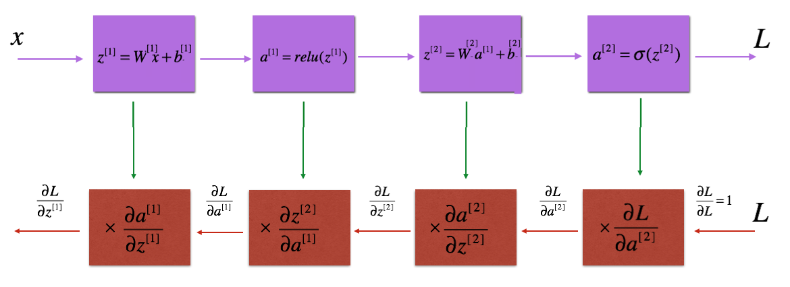

# Forward and Backward step

nn에서의 forward와 backward의 propagation을 수학적으로 증명하고, 이를 코드로 나타내보아, 각 변수 및 상태에 대해서 세세히 알아보는 시간을 가져보자.

## notation

deep nn을 구현하면서, 마치 logistic regression layer가 여러층 쌓인 것과 같아진다. 따라서, 총 3가지를 기준으로 notation을 정의한다.

- #layer
- #unit
- #train example

따라서 위에 3가지의 값에 따라 변수에 superscript square bucket, round 등으로 표시한다.

$$
a^{[layer](train\ example)}_{unit} = a^{[l](m)}_{n}
$$

따라서 각 차원 등등을 고려하여, 식을 위의 표기법을 따라 표현할 예정이며, 특히 #layer는 input layer을 세지 않는다. 이는 추후 뒤에 나올 backpropagation에서 $\frac{\partial J(w,b)}{\partial X}$가 필요하지 않기 때문이다.

### computing nn output

앞서 말했듯이, hidden layer의 input과 output은 can't observe하기 때문에, X와 Y를 통해 MLE을 기반으로 $\theta$를 수정해야 한다.

deep nn이라 하더라도, 기존에 x vector로 z를 연산 후, a를 출력하는 logistic regression이라는 layer을 stack한다고 생각하면 된다.

따라서 예시로 2번째 데이터셋으로, 1번째 layer, 1번째 노드 연산이 이루어진다고 해보면 연산은 아래와 같다.

$$
z^{[1](2)}_{1} = w^{[1]}_{1} \cdot X_1 + b^{[1]}
$$

이때 w와 b는 model parameter이므로, training example에 독립적이며, b는 현재 모델에서는 layer마다의 scalar값을 가진다. 따라서, b parameter은 unit number에도 독립적이며, 연산시 broadcasting된다.

### vectorization

따라서 위에서 unit들의 연산을 stacking하여, 하나의 벡터화 하면 아래와 같이 연산 된다.
가능할 수 있는 이유는 input equation을 stacking하여 matrix로 구성하면 output도 stacked into columns으로 corresponding되기 때문에 justification하다.

$$
Z^{[l]} = W^{[l].T} \cdot X + b^{[l]}
$$

$$
a^{[l]} = g^{[l]}(Z^{[l]})
$$

이는 layer number에 따른 general forward propagation compute식이다.
만약 연산이 햇갈린다면, 차원을 통해 연산을 검증할 수도 있다.

### dimention

1. w와 b는 model parameter이기 때문에, traning example에 종속되지 않는다. 따라서 차원에도 example수를 나타내는 m이 안들어가는 걸 알면 된다.

$$
W^{[l]}.shape = (n^{[l]},n^{[l-1]}), b^{[l]}.shape = (n^{[l]}, 1)
$$

해당 l layer에서의 output unit, input unit의 개수대로 matrix를 구성한다.

2. z와 a는 초기 $A^{[0]}$이라도고 부를 수 있는 X의 example 개수인 m에 따라 차원이 변화되어야 하므로, m에 대해 종속적이다. 또한 computed output이므로, input units에는 관련이없다. (다음 layer의 input으로 들어가는 건 관련이 있다.). 따라서 아래와 같이 표현할 수 있다.

$$
Z^{[l]}.shape = A^{[l]}.shape = (n^{[l]}, m)
$$

따라서 위에 식을 dimention을 기반으로 다시 표현해보면 아래와 같다.

$$
Z^{[l]} = W^{[l].T} \cdot X + b^{[l]}
$$

$$
(n^{[l]}, m) = (n^{[l]}, n^{[l-1]}) \cdot (n^{[l-1]}, m) + (n^{[l]}, 1)
$$

## activation function

기존에 sigmoid activation function을 사용한 이유는, $\hat{y}$의 값이 0부터 1로 나와야지 binary classification을 할 수 있었기 때문이다. 하지만 위의 범위가 필요없는 classification이나 regression문제들이 있거나, sigmoid activation의 gradient vanishing문제를 해결하기 위해 다른 여러가지 activation function을 사용한다.

activation function의 사용 이유 자체는 비선형 함수의 의의에 있다. 만약 activation function을 사용하지 않거나, linear activation function을 사용하여, layer을 중첩했다고 하면, 아무리 많은 layer을 중첩하여도, 하나의 linear layer로 표현이 가능해진다.

$$
a^{[1]} = Z^{[1]} = W^{[1]} \cdot X + b^{[1]}, a^{[2]} = Z^{[2]} = W^{[2]} \cdot a^{[1]} + b^{[2]}
$$

$$
a^{[2]} = Z^{[2]} = W^{[2]}(W^{[1]} \cdot X + b^{[1]}) + b^{[2]} = W^{[2]}W^{[1]}X + W^{[2]}b^{[1]}
$$

$$
a^{[2]} = W^{\prime}X + b^{\prime}
$$

위와 같이 유도되므로, non-linear activation function의 필요성은 존재한다.

각 activation의 사용 이유와, 장단점을 확실히 파악하여, 모델설계시에 잘 활용해야 할 것같다.

### 1. sigmoid

$$
\sigma(Z) = \frac{1}{1 + \exp^{-Z}}
$$

- 장점 : 가장 기초적인 activation function이며, binary classifier에 사용된다.
- 단점 : y center가 0.5이다. z가 too large/small 할 시, derivative값이 0에 수렴하고, a값이 0또는 1으로, GD speed가 very slow하다.

### 2. tanh

$$
g(Z) = tanh(Z) = \frac{\exp^Z - \exp^{-Z}}{\exp^Z + \exp^{-Z}}
$$

$$
g^{\prime}(Z) = tanh^{\prime}(Z) = 1 - tanh^{2}(Z)
$$

- 장점 : y center가 0이므로, 좀 더 0을 중심적으로 GD가 가능하다
- 단점 : sigmoid와 같이, z가 too large/small 할 시, derivative값이 0에 수렴하고, a값이 0또는 1으로, GD speed가 very slow하다.

### 3. ReLU

$$
g(Z) = Relu(Z) = Z\ if\ Z\ >\ 0\ else\ 0
$$

$$
g^{\prime}(Z) = Relu^{\prime} = 0\ or\ 1
$$

(이때 Z의 값이 음수가 되는 경우는 거의 희박하므로, 조건문이 아닌 1로 리턴하기도 한다. )

- 장점 : Z > 0인 부분에서 linear하여, Z의 크기를 g(Z)가 잘 나태낼 수 있으며, 아무리 Z가 커도 derivative가 0이 아니므로, Gradient Descent에서 속도가 느려지지 않는다.
- 단점 : Z < 0인 hidden unit이 slope가 0이라 **Dying ReLU** 현상이 일어날 수 있다.
- 고려할 점 : Z = 0에서 미분 불가능하지만, Z exactly zero probablity is 0이기 때문에 ($P(Z=0 | Z) = 0$, 확률밀도함수이기 때문에), 이 점은 무시해도 괜찮다.

### 4. Leaky ReLU

$$
g(Z) = leakyRelu(Z) = Z\ if\ Z\ >\ 0\ else\ Z*0.01
$$

0.01의 숫자는 여러 hyperparameter의 실험으로 general하게 사용되는 숫자이며, 모델에 따라 이 값을 수정하여, Leaky ReLU를 정의해도 된다.

- 장점 : Z > 0인 부분에서 linear하여, Z의 크기를 g(Z)가 잘 나태낼 수 있으며, 아무리 Z가 커도 derivative가 0이 아니므로, Gradient Descent에서 속도가 느려지지 않는다. Z < 0 인 부분에서도 $slope \neq 0$ 이므로, dying relu 현상을 고려할 필요가 없다.

## computation

각 step에 따른 계산 부분의 식이 많아, 노트에 식을 정리하였다. 사진 순서대로 식의 뜻을 풀이하면서 서술하겠다.

우선 일반화를 위해 input을 $a^{[l-1]}$으로, output을 $a^{[l]}$으로 표현함으로써, layer number인 l에만 식이 종속되도록 했다.

2단계로 vectorization or stacking 과정을 해주었는데, 맨처음에는, unit들의 compuation을 묶어, 한개의 layer 연산은 한번에 이루어지도록 하였다.

그리고 sample 여러개 (m개)를 동시에 연산하기 위해, vectorization을 하였는데, 이때 각 training example들은 서로 독립적이므로, column들을 concat한 형태라고만 생각하면 편할 듯 하다.

또한 backward step도 서술하였다. 이때, 우리는 w,b ($\theta$)을 수정함으로써, cost function의 값이 최소가 되도록 해야 한다. (MLE는 cost function 특징인 negative함을 없애줌으로써로 관점을 바꿀 수 있을 듯 하다.)

    
    

그래서, 위 사진과 같이, 각 forward step에서의 cache에 저장되어 있던 Z,A값들을 토대로, 각 레이어별의 w와 b의 grad들을 역 연산으로, output $\rightarrow$ input layer 방향으로 연산한다.

일반화 하는 과정에서 $\partial A^{[l]}$값을 구하면, 아래 hidden layer의 input값인 $\partial A^{[l-1]}$을 연산할때는, 굳이 cost function이 필요 없다는 것이다. 그 사이 연산에 대한 편미분만 진행해주면 되는 것이었다.

추가로 activation function 종류별에 따른 derivative 들을 서술하였다.

중간에 $\frac{1}{m}$을 취해준 부분이 있는데, 이는 각 model parameter의 gardient연산이 끝나면 마지막에 한번만 실행해주는 것이다. 그 이유는 m개의 sample을 동시에 연산하였기 때문에, 값어치가 m배 만큼 부풀러져 있어, 이를 평균화 해준 것이다.

따라서 마지막 식과 같이, l에 따른 $\partial A^{[l-1]}$와 $\partial A^{[l]}$의 점화식을 유도했다.

## random initialization

layer을 쌓는 이유와, 각 layer내 unit 수를 늘리는 이유는 단순하다. 더 많은 연산을 처리함으로써, feature vector에서의 pattern을 찾고, 더욱 더 complicated problem solving 하기 위함이다. 하지만 layer을 쌓을 때 주의해야 할 점은 앞에서 다루었고, 이번에는 한 layer 내 unit initialization으로 인한 computation symmetry 문제를 다루겠다.

2 logistic regresstion stacked model 이 있다고 해보자. 이때, hidden layer의 unit이 2개라고 했을때, 이를 똑같은 w,b로 initalization하여, 연산을 한다고 하면, fully connected라고 했을 때, 연산되어 나오는 activation function의 값이 동일하다.

이로 인해 backpropagation으로 gradient를 계산해도, 똑같은 연산이 이루어졌으므로, 똑같은 가중치 변화량을 받고, 똑같이 가중치를 update할 것이다. 따라서, random의 수로 initialization하는 것이다.

추가로 w,b를 너무 큰 수로 초기화시, sigmoid/tanh와 같은 함수를 사용시, Gradient Descent 속도가 매우 느려질 수 있다. 따라서 z is too big문제를 방지하기 위해 random수를 아주 작은 수로 설정해야 한다. (0.01을 곱하는 것이 관례적이다)

이로써, cause saturated on activation function 을 방지하여, unit마다의 다른 연산을 구현할 수 있다.

## Deep nn

Deep이라고 칭하는 이유는 layer가 deepper 되기 때문이다. 하지만, large nn일수록 학습시킬 데이터가 충분해야 하며, 학습 시간 및 과적합 요소도 고려해야 한다. 그래서, 아래의 단계 처럼 천천히 hidden layer을 증가시키면서, 문제에 걸맞는 크기의 nn model을 정한다.

$$
Shallow(logistic\ regression) \rightarrow 1\ hidden\ layer \rightarrow large\ hidden\ layer
$$

### why deep representation?

총 2가지의 관점으로 설명할 수 있다.

#### 1. intuition about deep representation

CNN을 예시로 생각해보자. kernel filter로 input image를 한번 compute 하면, 간단한 edge, feature 수준의 figure out이 이루어 질 것이다. 하지만 점점 layer가 deeper 될 수록, more complex feature detect가 가능해진다.

따라서 얼굴인식 CNN이라고 예시를 들면, 맨 처음에는 edge, 그 다음에는 different part, 마지막에는 various types faces detect가 가능해지는 것이다. 이는 여러 domain분야에서 동일하게 작용되는 법칙이다.

#### 2. crucuit theory

만약에 L-layer의 deep nn을 1-layer로 구현하기 위해서는 $2^L$개의 노드가 필요하다. 이는 연산이 지수적으로 증가하게 된다. 따라서 최소한의 연산 (2 input, 1 output)으로 unit(node)를 구성한다고 하면 $log L$이라는 이득을 취할 수 있다. 따라서 연산적으로 exponentially increasing 하기 때문에, deep 부분에서 이득을 취할 수 있다.

### hyperparameter vs parameter

hyperparameter: control ultimate parameter. 직접적으로 변경이 가능하며, 변경요소가 모델 학습 및 예측에 반영이 됨.

parameter: 직접 변경할 수 없으며, 학습을 통해 변경됨. 또한 모델에 종속되어, hyperparameter을 통해 변경이 됨.

hyperparameter을 한번에 찾을 수는 없기 때문에, empirical process를 통해 try out a range of a value을 통해 effective 한 value를 찾아서 hyperparameter로 설정하는 것이 모델 설계에 중요하다.
